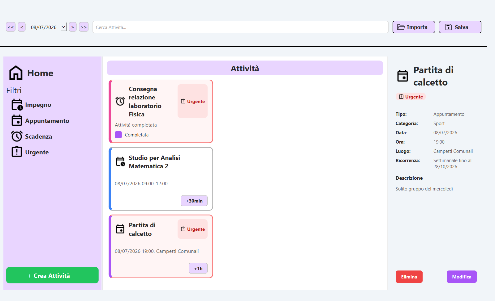
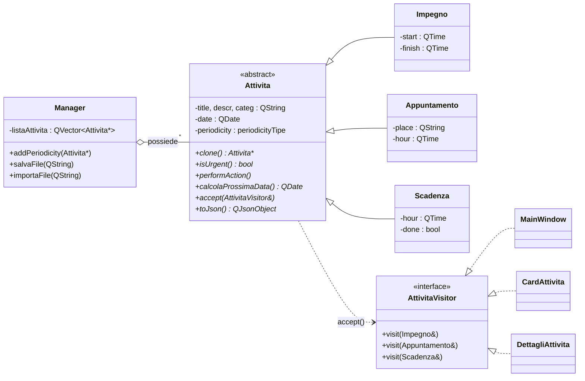
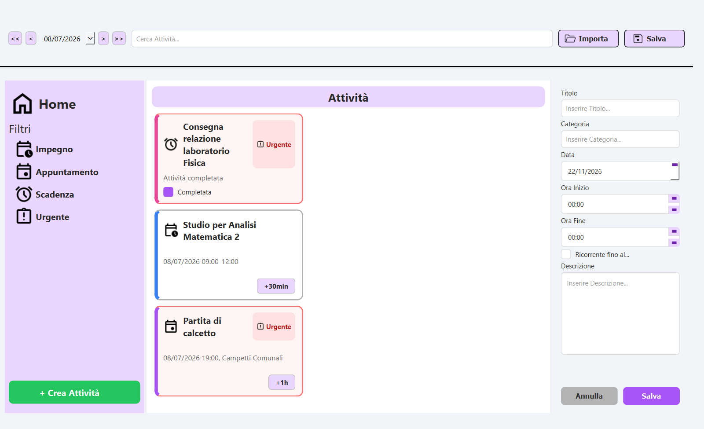

# Agenda — Gestore di attività in C++ / Qt 6


Applicazione desktop per organizzare **impegni, appuntamenti e scadenze**: le attività si creano, si modificano, si filtrano per tipo o urgenza, si cercano per testo e si salvano o caricano da file JSON. Le attività possono anche ripetersi ogni giorno, settimana o mese.

Progetto del corso di **Programmazione ad Oggetti** (Laurea in Informatica, Università di Padova, a.a. 2025/26). È scritto in C++17 con Qt 6 Widgets, senza librerie esterne. Il progetto punta su una gerarchia di classi polimorfa e su una separazione netta tra **modello** e **interfaccia grafica**.



---

## Indice

- [Funzionalità](#funzionalità)
- [I tre tipi di attività](#i-tre-tipi-di-attività)
- [Architettura](#architettura)
- [Struttura della repository](#struttura-della-repository)
- [Compilazione ed esecuzione](#compilazione-ed-esecuzione)
- [Guida all'uso](#guida-alluso)
- [Formato del file JSON](#formato-del-file-json)
- [Documentazione](#documentazione)

---

## Funzionalità

- **Creazione, modifica ed eliminazione** di tre tipi di attività, ognuno con un proprio form.
- **Navigazione per data**: si scorre di un giorno o di una settimana alla volta (`<` `>` `<<` `>>`), oppure si sceglie la data dal calendario.
- **Filtri** per tipo (Impegno / Appuntamento / Scadenza) e per **urgenza**, combinabili tra loro.
- **Ricerca testuale istantanea** su titolo, categoria e descrizione.
- **Urgenza calcolata in automatico**, con regole diverse per ogni tipo; le attività urgenti hanno un badge e un bordo rosso.
- **Azioni rapide** direttamente dalla card: *+30 min* per un impegno, *+1 h* per un appuntamento, *completata* per una scadenza.
- **Ricorrenze** giornaliere, settimanali o mensili fino a una data di fine.
- **Persistenza JSON**: *Importa* aggiunge le attività di un file a quelle già presenti, *Salva* scrive tutto su un file a scelta.
- **Layout responsive**: la griglia passa da 1 a 4 colonne in base alla larghezza; sotto i 700 px le colonne laterali spariscono (modalità compatta).

## I tre tipi di attività

Tutte le attività hanno in comune titolo, descrizione, categoria, data, id e ricorrenza. Ogni sottoclasse aggiunge i propri campi e un comportamento specifico:

| | **Impegno** | **Appuntamento** | **Scadenza** |
|---|---|---|---|
| Campi specifici | ora di inizio e ora di fine | luogo, ora | ora limite, stato *completata* |
| È urgente se… | mancano meno di 2 h all'inizio, oppure è in corso | è oggi, oppure mancano meno di 2 h | mancano meno di 24 h, oppure è già scaduta |
| Azione rapida (`performAction()`) | sposta inizio e fine di 30 min | sposta l'orario di 1 h | segna come completata / da completare |
| Si ripete (`calcolaProssimaData()`) | sì | sì | no |
| Colore della card | blu | viola | rosa |

## Architettura

Il codice è diviso in due strati:

- **Modello** (`Attivita`, `Impegno`, `Appuntamento`, `Scadenza`, `Manager`): non conosce la GUI e dipende da Qt solo per i tipi di base (`QString`, `QDate`, `QJsonObject`).
- **Vista** (`MainWindow`, `CardAttivita`, `DettagliAttivita`, `Form*`): widget Qt costruiti da file `.ui` di Qt Designer, che leggono e modificano il modello tramite la sua interfaccia pubblica.



### Scelte progettuali principali

**Polimorfismo al posto dei controlli sul tipo.** Urgenza, azione rapida, riepilogo testuale, icona, serializzazione e calcolo della ricorrenza sono metodi virtuali puri di `Attivita`. Il `Manager` e la logica dell'app lavorano su `Attivita*` senza dover sapere di che tipo concreto si tratti.

**Pattern Visitor per la GUI.** Alcune parti dell'interfaccia cambiano in base al tipo: il colore e i pulsanti della card, le righe del pannello dettagli, il form di modifica da aprire. Per gestirle senza inserire codice grafico nel modello e senza catene di `if` sul tipo, ogni widget implementa `AttivitaVisitor` e chiama `attivita->accept(*this)`. Il *double dispatch* sceglie poi il `visit()` giusto:

```cpp
// MainWindow: apre il form di modifica corretto per qualunque tipo di attività
void MainWindow::onModificaAttivita(Attivita* a) { a->accept(*this); }

void MainWindow::visit(Scadenza& s)     { apriFormModifica<FormScadenza>(&s); }
void MainWindow::visit(Impegno& i)      { apriFormModifica<FormImpegno>(&i); }
void MainWindow::visit(Appuntamento& a) { apriFormModifica<FormAppuntamento>(&a); }
```

Aggiungere un nuovo tipo di attività significa quindi implementare la sottoclasse e un `visit()` in ogni visitor. Se un `visit()` manca, il compilatore dà errore, perché l'interfaccia è astratta.

**Prototype per le ricorrenze.** `Manager::addPeriodicity` genera le occorrenze successive clonando l'ultima attività creata (`clone()`) e chiedendole la data seguente (`calcolaProssimaData()`). Entrambe le chiamate sono polimorfe, quindi il `Manager` non sa quale tipo concreto sta copiando.

**Template per evitare duplicazioni.** Il flusso "apri form → salva → sostituisci nel modello → aggiorna la vista" è lo stesso per tutti i tipi, quindi è scritto una sola volta in `apriFormModifica<FormT, ModelT>`.

**Gestione della memoria.** Il `Manager` possiede le attività: le libera con `qDeleteAll` alla distruzione e con `delete` quando un'attività viene rimossa o sostituita. I widget Qt sono gestiti dalla gerarchia parent/child.

**Serializzazione.** Ogni classe scrive i propri campi in `toJson()`, mentre i campi comuni vengono da `Attivita::baseJson()`. In lettura, il `Manager` ricostruisce l'oggetto giusto in base al campo `"tipo"`.

## Struttura della repository

```
.
├── model/
│   ├── ProgettoPaO2026.pro       # progetto qmake
│   ├── resources.qrc             # icone SVG incluse nell'eseguibile
│   ├── headers/                  # dichiarazioni (.h)
│   ├── sources/                  # implementazioni (.cpp)
│   ├── ui/                       # layout Qt Designer (.ui)
│   ├── icons/                    # icone SVG
│   └── database_consegna.json    # dataset di esempio (105 attività)
├── docs/screenshots/             # immagini usate in questo README
├── Specifiche/                   # specifiche del progetto
├── Relazione_PaO_Antonio_Tufano.pdf
└── Dockerfile                    # ambiente Qt 6 standard del corso
```

## Compilazione ed esecuzione

**Requisiti:** Qt 6 (moduli `widgets` e `svg`) e un compilatore C++17.

### Opzione 1 — Qt Creator (consigliata)

1. Apri `model/ProgettoPaO2026.pro` con Qt Creator.
2. Scegli un kit Qt 6, ad esempio *Desktop Qt 6.x MinGW 64-bit* o *GCC 64-bit*.
3. Premi **Run** (`Ctrl+R`).

### Opzione 2 — Riga di comando

**Linux / macOS**

```bash
cd model
mkdir build && cd build
qmake6 ../ProgettoPaO2026.pro   # oppure "qmake", a seconda dell'installazione
make -j$(nproc)
./ProgettoPaO2026
```

**Windows (Qt + MinGW)**, da un *Qt 6 MinGW command prompt*:

```powershell
cd model
mkdir build; cd build
qmake ..\ProgettoPaO2026.pro
mingw32-make -j8
.\release\ProgettoPaO2026.exe
```

### Opzione 3 — Docker (Linux con X11)

Il `Dockerfile` crea l'ambiente standard del corso (Ubuntu 24.04 + Qt 6). Per compilare l'app nel container e vederne la finestra sul desktop host:

```bash
docker build -t pao-qt .
xhost +local:docker
docker run --rm -it \
  -e DISPLAY=$DISPLAY \
  -v /tmp/.X11-unix:/tmp/.X11-unix \
  -v "$(pwd)":/home/student/progetto \
  pao-qt
# dentro il container:
cd progetto/model && mkdir -p build && cd build && qmake6 .. && make -j$(nproc) && ./ProgettoPaO2026
```

## Guida all'uso

L'app si apre **vuota**. Per avere subito dei dati da esplorare conviene caricare il dataset di esempio:

1. **Importa i dati di esempio.** Clicca **Importa** in alto a destra e scegli `model/database_consegna.json`.
2. **Vai a una data con attività.** Il dataset va da luglio 2026 a febbraio 2027. Imposta ad esempio **08/07/2026**: con `<` / `>` ti sposti di un giorno, con `<<` / `>>` di una settimana.
3. **Filtra e cerca.** I filtri a sinistra si possono combinare (ad esempio *Impegno* + *Urgente*). La barra di ricerca filtra mentre scrivi. **Home** azzera filtri e ricerca.
4. **Apri i dettagli.** Clicca su una card: a destra compare la scheda completa, con i pulsanti **Modifica** ed **Elimina**.
5. **Usa le azioni rapide.** Dalla card puoi spostare un impegno di +30 min o un appuntamento di +1 h, oppure spuntare una scadenza come completata.
6. **Crea un'attività.** Clicca **+ Crea Attività**, scegli il tipo e compila il form. Con *Ricorrente fino al…* l'attività viene ripetuta (ogni giorno, settimana o mese) fino alla data indicata.
7. **Salva.** Le modifiche restano in memoria finché non premi **Salva** e scegli il file `.json` di destinazione. Al prossimo avvio puoi ricaricarlo con **Importa**.



## Formato del file JSON

Il file contiene un array di oggetti. Il campo `"tipo"` indica la classe concreta; `"ricorrenza"` vale `0` (nessuna), `1` (giornaliera), `2` (settimanale) o `3` (mensile).

```json
[
  {
    "tipo": "Impegno",
    "id": 18,
    "titolo": "Studio per Analisi Matematica 2",
    "descrizione": "Ripasso serie di Fourier ed equazioni differenziali",
    "categoria": "Università",
    "data": "2026-07-08",
    "start": "09:00:00",
    "finish": "12:00:00",
    "ricorrenza": 0,
    "fineRicorrenza": ""
  },
  {
    "tipo": "Appuntamento",
    "titolo": "Partita di calcetto",
    "data": "2026-07-08",
    "luogo": "Campetti Comunali",
    "ora": "19:00:00",
    "...": "..."
  },
  {
    "tipo": "Scadenza",
    "titolo": "Consegna relazione laboratorio Fisica",
    "data": "2026-07-08",
    "ora": "23:59:00",
    "done": true,
    "...": "..."
  }
]
```

## Documentazione

- [`Relazione_PaO_Antonio_Tufano.pdf`](Relazione_PaO_Antonio_Tufano.pdf): relazione tecnica del progetto.
- [`Specifiche/project-specifications.pdf`](Specifiche/project-specifications.pdf): specifiche del progetto assegnate dal corso.

---

**Autore:** Antonio Tufano — [@antotuf06](https://github.com/antotuf06)
